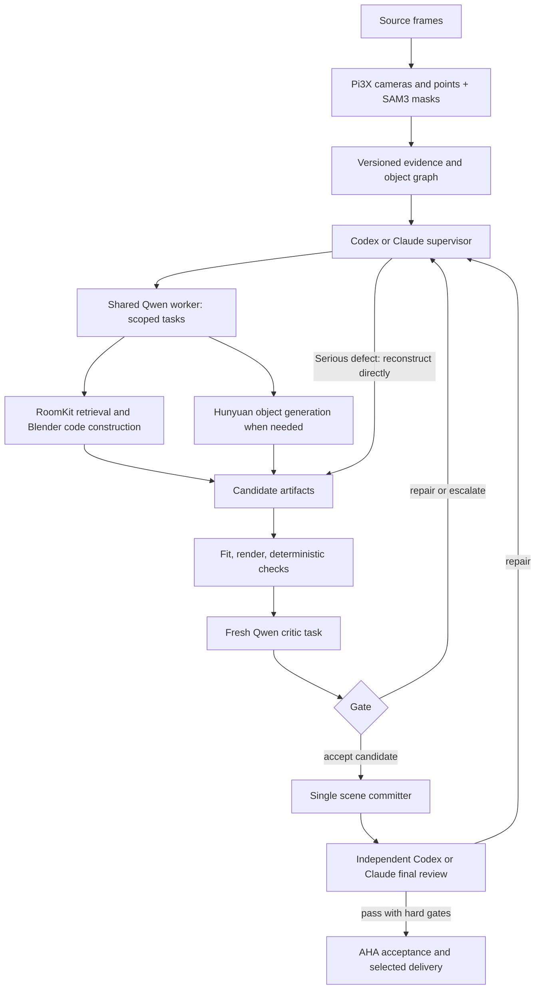

# Agen3D designv2: delegated, executable scene reconstruction

Date: 2026-11-15. Status: construction-stage implementation started; not end-to-end benchmarked.

Implementation: [AHA runtime](../src/agen3d/multiagent/aha/README.md).
Verified capabilities and remaining dependencies are recorded in
[setup status](../src/agen3d/multiagent/archive/SETUP_STATUS.md). Video/dataset reference
preparation now runs inside the AHA job and shared cost ledger. Complete delivery
and full-room quality validation remain unfinished.

This is the single forward architecture. “designv2” is the document revision,
not the old `v2_specialists` runtime policy. Stop developing or comparing parallel
V1/V2/V3 systems. Keep their historical outputs intact.

## 1. Decision

Use **`external/aha-3d` as the reconstruction base**, with a thin delegation layer
in Agen3D. Do not rebuild its scene workflow inside the current hull-oriented
multiagent runner. Use **Codex or Claude as supervisor**, one shared **Qwen vision-language worker**
for bounded perception, construction, and critique tasks, and deterministic
geometry/Blender services for execution. Add **Hunyuan as an object-generation
tool**, only when retrieval or procedural construction cannot produce a suitable
object. Codex/Claude should delegate ordinary work and intervene on difficult,
high-impact failures. Use a fresh strong-model context for final review.

The main change is an executable construction loop:

**observe → choose representation → construct → render → compare → repair → commit**.

Recovering points and moving hulls is insufficient. The system needs editable
room structure, suitable furniture geometry, materials, and evidence-backed
object identity. Do not expect a cheaper model swap to supply missing capabilities.

## 2. What failed in the current implementation

Inspected local evidence:

- [Saved run report](../recon/ai2thor_floorplan209/v1/report.json):
  `completed_with_unresolved`; final judge requested repair.
- [Selected artifact manifest](../recon/ai2thor_floorplan209/v1/selected.json):
  all 27 tracked objects were `observed_point_hull`; no applied RoomKit asset.
- [Pipeline runner](../src/agen3d/multiagent/archive/pipeline/runner.py): the planning
  prompt requests a summary while the scheduler fixes stage order. Asset batches
  do not require successful selection mutations before advancing. `ask()` only
  raises for a particular provider-failure abstention, not every ineffective task.
- The same runner permits at most three small transform corrections per repair
  round. It cannot resolve missing walls, wrong topology, or absent furniture parts.
- [Blender assembler](../src/agen3d/multiagent/archive/pipeline/blender_scene.py):
  collection assets or observed-point hulls plus a contextual floor; no general
  room-shell/opening authoring stage.
- [Specialist adapter](../src/agen3d/multiagent/archive/specialist_worker.py) already has
  Hunyuan and SAM 3D branches. Their existence is not end-to-end integration:
  the raw pipeline initializes the agent with `services={}` and does not route
  generated object candidates into its construction loop.

The report records 628.5 seconds overall, 52 cheap-model calls, and 335.3 seconds
across two local-review stages. Known worker charges were $0.1115; strong-model
and some compute charges were unknown. This is not a measured total room cost.
Repeated critique consumed time without providing the construction tools needed
to fix the findings. Duplicate associations remain a hypothesis to investigate,
not a verified count derived from these manifests.

## 3. What to adopt from AHA-3D and research

AHA-3D explicitly treats Pi3X geometry as reference evidence, then authors an
editable room, searches assets, builds missing geometry, and reviews actual
source-camera renders. Preserve that distinction. Reuse its RoomKit helpers,
stable IDs, orientation metadata, materials, and isolated object review ideas;
do not copy its full human-motion system into this room-reconstruction task.
See [local workflow](../external/aha-3d/docs/REAL2SIM_PIPELINE.md),
[RoomKit helpers](../external/aha-3d/src/aha3d/blender/roomkit.py), and [R1](references.md#r1-aha-3d).

Executable scene programs and staged render feedback are supported by
[LEGO-Anything](https://arxiv.org/abs/2609.36380) and
[Thinking in Blender](https://arxiv.org/abs/2606.02580). The former also reports
regressive edits and unreliable self-evaluation. These motivate immutable
candidates, rollback, and independent review—not an assumption that unrestricted
code generation will reconstruct every scene accurately. [R2–R3](references.md#r2-lego-anything)

[Infinigen Indoors](https://openaccess.thecvf.com/content/CVPR2024/html/Raistrick_Infinigen_Indoors_Photorealistic_Indoor_Scenes_using_Procedural_Generation_CVPR_2024_paper.html)
supports the usefulness of procedural assets and explicit placement constraints.
[Holodeck](https://yueyang.ai/holodeck/) combines language-guided scene generation
with asset retrieval. Borrow these mechanisms; neither establishes faithful
reconstruction of our particular video. [R7–R8](references.md#r7-infinigen-indoors)

## 4. AHA-3D as the base: concrete delegation boundaries

Keep AHA's authored `.blend`, semantic object IDs, reference artifacts, inspection
packets and acceptance records as the authoritative scene workflow. Agen3D adds
model transport, bounded task dispatch, accounting, and candidate construction
adapters. Do not maintain a second canonical box-based scene that can diverge
from the Blender scene. An auxiliary object/task index may reference AHA IDs.

### Keep the existing machinery

- **Reference reconstruction:** `tools/layout_inspection/build_reference.py`
  already coordinates Pi3X, semantics, alignment and reference geometry. Keep
  those numerical/model stages; Qwen can propose source selections or flag bad
  alignment, but should not replace camera/depth inference with guessed numbers.
- **Geometry and materials:** `src/aha3d/blender/roomkit.py` and `cabinets.py`
  provide reusable authoring helpers. Keep these and the existing asset catalog.
- **Replacement and placement:** `src/aha3d/blender/variants.py` has
  `plan_variant`, `place_asset`, and `apply_variant`. Reuse its compatibility,
  orientation and stable-slot behavior instead of swapping anonymous meshes.
- **Evidence generation:** `src/aha3d/workflow/object_review.py` exports saved
  geometry and builds source/plan/side object-focus packets with provenance.
  `tools/layout_inspection/agent_review.py` is a deterministic packet/diagnostic
  generator despite its name; do not replace it with a language model.
- **Gates and delivery:** retain `workflow/layout_gate.py`, `acceptance.py`,
  `preview_gate.py`, and `results/registry.py`. These provide the authoritative
  acceptance/selection mechanism. Map task status into this workflow rather than
  introducing competing acceptance files in the AHA run directory.

### Delegate these decisions to Qwen first

1. **Source inventory and evidence triage:** propose categories, visible objects,
   informative frames and uncertainty from real images; numerical tools and the
   supervisor resolve ambiguous associations and global coordinate decisions.
2. **Catalog selection:** choose among a few retrieved thumbnail candidates with
   dimensions and orientation metadata. Execute through existing AHA asset tools.
3. **Local visual critique:** read AHA object-focus packets and emit observations
   and actionable defects. Keep packet generation and provenance checks unchanged.
4. **Bounded repairs:** choose parameter changes for a known object, material or
   helper-based builder. Execute in a candidate copy and regenerate affected
   evidence, including neighbors and occlusion changes.
5. **Simple object construction:** write small helper-based Blender programs for
   straightforward furniture. Start with constrained builders; arbitrary complex
   architecture and difficult topology are strong-agent escalation tasks.

Qwen replaces repeated agent decisions, not Pi3X, SAM3, Blender, numerical
measurement or acceptance logic. The source inventory still needs a coverage
sweep: a critic that only sees existing object IDs cannot discover every missing
object or wall opening.

### Add Hunyuan at the missing-asset boundary

Hunyuan replaces selected manual object-modeling work, not the room builder.
Use the chain: source mask/crop → shape candidate → Blender import → normalize
axes/support/scale → fit to source evidence → object review → accepted replacement.

The current `variants.py` import path expects a registered Blender collection
with orientation metadata; it is not a general drop-in GLB importer. Add a
conversion/staging adapter that produces a candidate `.blend` collection and
metadata, then hands it to AHA placement/replacement. Confirm front direction
from evidence; do not mark unknown generated orientation as trusted automatically.
Do not register failed candidates in the shared asset catalog. Initially keep
accepted generated assets scene-local; promoting reusable assets is separate.

### Exact visual-review integration seam

`tools/review_images.py` wraps Codex; `workflow/review_contract.py::run_reviewer`
invokes `codex exec` with actual image attachments. Its validator currently
requires `image_delivery.method == 'codex_exec_images'`.

Therefore Qwen is **not** a configuration-only replacement. First use Qwen for
advisory local review and retain the existing Codex gate. Then introduce an
explicit provider-neutral transport interface for Qwen and, when selected,
Claude, preserving image order/hashes, request identity, candidate revision,
required subjects/views/aspects, and unresolved-finding rejection. Transport
receipts must describe the actual backend; never label Qwen input as Codex image
delivery. A successful transport receipt proves delivery, not visual correctness.

`pipeline/runner.py::ensure_layout` and `review_layout` are existing gate
integration points. The delegation layer can prepare repairs and submit reviewed
evidence there. The pipeline still needs authored scene inputs: this is an agent
workflow to extend, not an already-complete autonomous RGB-to-room API.

### First integrations, in order

1. Run Qwen on an existing AHA object packet; compare its defects with strong
   review before allowing it to close local issues.
2. Delegate one catalog selection and parameter repair; preserve AHA IDs/gates.
3. Add helper-based construction and a strong-agent takeover on the same task.
4. Add Hunyuan conversion for one missing irregular object.
5. Exercise the integrated source-to-room workflow using AHA evidence/acceptance.

These are incremental integrations into one system, not alternate architectures.
No upstream files were modified during this design audit.

## 5. One architecture, few model deployments



These are task roles, not a separate resident model for every box. One scheduler
dispatches them. Workers never concurrently mutate the canonical `.blend`.

### Supervisor: Codex or Claude

Choose one configured strong model for a run. It sees source overview, evidence
coverage, candidate results, unresolved issues, and remaining time/cost. It emits
an executable task plan: targets, dependencies, representation choices, success
conditions, and repair priorities. The scheduler must actually execute that plan.

Default responsibilities: initial plan, room-shell review, grouped escalations,
and final review in a fresh context. It does not routinely inspect every crop,
select every catalog entry, or write every object's code. A failed high-impact
object may receive a strong-model construction task. The supervisor is explicitly
allowed to perform expensive reconstruction itself when it finds a serious defect.

**Takeover policy:** trigger immediately for a seriously wrong room shell/camera
basis, missing salient structure, or unusable major-object geometry; do not force
cheap retries first. Also trigger after one unsuccessful cheap repair, conflicting
evidence, or an object whose complexity exceeds the worker's capabilities. The
supervisor may write substantial Blender code, rebuild an object or structural
region, change the representation/backend, or request higher-quality generation
and new reference computation when justified.

Scope the takeover to the failed object or dependent region when possible. A
global basis failure can justify a broader reconstruction and invalidates affected
placements/renders. Give the strong agent the original evidence, actual candidate
files, failure history, and remaining budget—not just Qwen's summary. Execute
through the same candidate isolation, AHA checks and versioned commit path.

Reserve strong-repair capacity before routine work consumes the budget; separate
it from final-review capacity. Expensive recovery is authorized within the run's
configured cost/time limits, not an unlimited-spend exception. Log its trigger,
scope, cost and result, then return routine tasks to Qwen. Use a fresh strong
review context after takeover; the builder's own success claim cannot accept it.

### Shared worker: Qwen3-VL-30B-A3B-Instruct initially

Use one endpoint for inventory, candidate selection, helper-based Blender
programs, and local critique, with separate contexts and role permissions.
This model is already represented in the existing configuration. Its suitability
for our construction tasks remains unverified. Official Qwen material documents
visual grounding and multimodal capabilities, not reliable room reconstruction.
[R4](references.md#r4-qwen3-vl)

Use hosted inference initially to avoid competing with geometry/generation on
one GPU. Verify image input, structured output, and endpoint availability with
small task fixtures before a room run. The earlier 8B provider failure was an
availability problem; do not presume either that it is resolved or that a larger
Qwen model is automatically better. If the selected endpoint fails the smoke
test, stop and resolve that dependency rather than changing models silently.

### Geometry and generation services

Pi3X supplies estimated cameras/points; SAM3 supplies masks. Numerical code fits
planes, associations, object transforms, support and projection. Hunyuan supplies
object shape candidates; Blender executes code, imports meshes, and renders.
These services are not reasoning agents or judges.

## 6. Representation policy: code and meshes together

Make one representation decision per object, based on evidence and expected
repairability. Do not run every backend for every object.

1. **Room shell, windows, doors, trim:** procedural Blender geometry. Infer wall
   planes and opening locations from multiple views; retain uncertainty. Build
   actual openings, not rectangular decals or hulls covering holes.
2. **Furniture with a close catalog match:** retrieve RoomKit candidates using
   category, proportions, and thumbnail views. Show only the best few candidates
   beside source crops. Preserve materials, object roots, front axis and supports.
3. **Structured furniture without a good match:** worker writes a small Blender
   program using RoomKit primitives and helpers: shelves, table legs, cabinet
   panels, chair seats/backs, and similar parts. Expose dimensions as parameters.
4. **Irregular/decorative objects or failed procedural fits:** masked source crop
   to Hunyuan shape generation; normalize and fit the returned mesh, then render
   against other observed views. Texture only after shape passes. This route is
   especially worth trying for curved decor; its quality on thin parts, plants,
   and heavily occluded items must be checked rather than assumed.
5. **Insufficient evidence:** keep an explicitly unresolved proxy for diagnostics.
   A salient visible object cannot pass final acceptance as an observed-point hull.

Hunyuan3D-2.1 is an image-to-shape/PBR asset system, not a room-layout solver or
critic. Its documented VRAM figures are 10 GB shape, 21 GB texture, 29 GB combined;
these are upstream figures, not measurements on this machine. Initially integrate
shape only and use existing/simple materials. [R5](references.md#r5-hunyuan3d-21)

SAM 3D Objects is relevant because it accepts masked objects in natural images
and predicts shape, pose and layout. Defer it from the first implementation to
avoid adding a second generator integration. Keep its existing adapter as a
future alternative if Hunyuan fails on cluttered source crops. Its predicted
pose would still need conversion and validation in the common scene frame.
[R6](references.md#r6-sam-3d-objects)

## 7. Construction contract

Each worker receives a compact, source-bound packet:

- Stable object/structure ID, scene version, category and support relationships.
- Two to four informative source crops with surrounding context, masks, frame
  IDs, crop transforms, predicted cameras, and points/confidence where available.
- Estimated dimensions and uncertainty, world units/frame convention, known
  front direction, and which bounds are actually visible.
- Relevant helper signatures, catalog thumbnails, previous candidate feedback,
  and a bounded budget. Do not attach the whole catalog and all scene history.

Each construction task returns files, not just a claim of success:

```text
candidate/<task-id>/
  build.py          # procedural route; reproducible entry point
  params.json       # dimensions/material choices and seed
  object.glb        # interchange artifact when applicable
  object.blend      # editable local asset
  manifest.json     # parent version, target IDs, evidence, representation, axes
  validation.json   # execution/import/geometry results
  renders/          # isolated views and matched source-camera previews
```

For a retrieved asset, record catalog ID/revision instead of inventing build code.
For a generated mesh, record model/checkpoint, crop/mask, seed and fitting transform.
The canonical scene stores geometry references and semantic parts, not only boxes.

Proposed tool surface: `search_assets`, `submit_build_program`,
`build_candidate`, `generate_object`, `fit_candidate`, `render_candidate`,
`measure_candidate`, `submit_candidate`. These are new interfaces to implement;
they are not claims that the existing registry exposes them.

The worker writes candidate-local code through a structured artifact tool; the
executor runs it in isolated background Blender. Inputs and asset libraries are
read-only; output writes are confined to the task directory, with no network,
credentials, or benchmark labels, and with process/time/memory limits. Python
import restrictions alone are not isolation. Native unrestricted CLI shell
access is unnecessary for routine workers.

The committer validates target IDs and parent scene version, imports the complete
object hierarchy, and saves a new scene revision. It rejects stale/conflicting
patches. Keep the accepted parent intact for rollback.

## 8. Gates that prevent another hull-only delivery

**Evidence gate:** review floor/upright and camera projection before construction.
Mask identity must agree across views where available; ambiguous merge/split
decisions remain explicit. Pi3X scale and single-view hidden dimensions are
estimates. Do not force arbitrary metric dimensions without an anchor.

**Execution gate:** `done` is valid only if expected tool receipts and artifact
postconditions exist. An asset decision must create a valid selection or an
explicit alternative construction task. Retry malformed output once with a
compact validation error; repeated failure escalates or blocks the task. Claims
such as “assets selected” without mutations never advance the stage.

**Candidate gate:** reopen the artifact; verify finite geometry, correct axes and
scale, required parts, material dependencies, support/contact, and no new severe
penetrations. Use mesh-aware checks where needed; boxes alone cannot validate
chair/table geometry. Render matched camera silhouettes, depth and appearance.
Compare occlusion-aware visible masks; do not penalize hidden geometry as though
it were observed. Confidence-weight predicted depth and expose disagreement.

**Review gate:** a separate Qwen critic identifies concrete defects with evidence
IDs, severity, affected views and suggested repair class. It cannot pass a hard
failure. The supervisor handles important disagreements and stalled repairs.
Fresh contexts reduce history bias but do not make the same model statistically
independent; final review remains with the strong model.

**Scene gate:** validate the shell first, then major furniture, then details and
materials. Render early/middle/late and other informative source views, plus a
novel diagnostic view for gross geometry defects. Reserve some source views from
local tuning for final checks. No scalar image score can hide missing structure.
Judge source similarity and geometry separately from image attractiveness.

Acceptance requires no unresolved critical findings, no proxies for required
salient objects, all committed artifacts loadable, and a strong final pass.
Insufficiently observed areas remain labeled unknown. Budget exhaustion produces
`incomplete_budget`; construction failure produces `blocked_construction`.
Neither is an accepted reconstruction. Only a pass may advance AHA's authoritative
acceptance and selected-delivery records. Delegation-layer candidate pointers are
diagnostic and cannot stand in for those records.

## 9. Reduce time and cost without pretending quality is guaranteed

Prioritize by visible impact, uncertainty, and observed defect severity. Repair
cameras/shell and prominent furniture before texture/detail. Spend one cheap
attempt plus one feedback repair by default, then escalate or change construction
route. Do not repeatedly critique an unchanged artifact.

Cache Pi3X/SAM3 evidence, crops, catalog thumbnails, generated meshes and renders
using input/code/model/config/scene identities. Reuse the saved failed run's
reference artifacts where their mappings and completeness check out; do not
claim cached tests include fresh inference cost. Use local crops for routine
checks and full scenes at milestones. Rerender affected views, with periodic
global checks for occlusion changes.

Queue local GPU work serially initially. Do not introduce multiple persistent
local VLMs, extra spatial models, fine-tuning, a learned router, or a large agent
chat network. Count retries, generation, rendering, strong escalations, and host
time. Unknown cost stays unknown; report elapsed time separately from money.

There is no defensible savings percentage or “no quality loss” claim yet.
The primary metric is cost and elapsed time per **accepted** reconstruction,
with failures and their expenses included. Model price alone is insufficient.

## 10. Short implementation path

### Step 1 — One vertical construction slice

Use AHA's scene authoring, reference preparation, object inspection and acceptance
workflow as the base. Reuse Agen3D's `providers.py`, ledger/store and model registry
where compatible, behind a thin integration layer. Do not extend the fixed
hull-oriented runner into a second scene engine. Add a construction queue whose
tasks reference AHA scene revisions and object IDs. Extend task contracts with
representation, geometry artifact, required receipts and construction status.
The supervisor's plan must drive tasks, rather than be a logged summary.

Add a candidate Blender executor and RoomKit helper surface first. On saved
FloorPlan209 evidence, demonstrate a room-shell section with an opening, one
retrieved furniture object, and one newly authored structured object. Inspect
multiple source views before attempting a full room. AHA's reference builder
expects a complete 32/64-frame bundle (or a shorter source's complete coverage);
the existing Agen3D cache is not automatically compatible. Validate frame coverage,
camera conventions, units and confidence artifacts before converting/reusing it;
regenerate missing references explicitly if necessary. Choose examples from actual
visible evidence; do not infer identities from benchmark labels.

### Step 2 — One generation route

Integrate the existing Hunyuan branch into the same candidate contract. Verify
pinned API/checkpoint compatibility, background removal, mesh export/import,
axis/scale normalization, multi-view fitting and caching. Demonstrate one
source-supported irregular object. Do not add SAM 3D or a texture-generation
stack in this step.

### Step 3 — One room pilot

Run the single architecture on FloorPlan209, with shell and major-object gates
before polishing. Inspect paired source renders and the saved `.blend`. Retain
an independent final review and separate offline evaluator. Do not spend on a
full pilot until the vertical slice and model/tool contract checks pass.

### Step 4 — Validate the cheap delegation

Use a small fixed set of object packets and successful artifacts to compare Qwen
decisions against strong review and deterministic outcomes. Record missed major
defects, false passes, construction success, escalation frequency, time and cost.
Include known bad candidates, so passing only easy objects cannot look reliable.
This is a small component check within one architecture, not three runtime forks.
Then use an additional room to check obvious overfitting to FloorPlan209.

Focused implementation checks: missing receipts cannot pass; a generated asset
can be reopened and assembled; stale candidates cannot overwrite accepted work;
a regressive patch rolls back; critical unresolved findings cannot create an
accepted manifest. Runtime code and tests are future work, not delivered here.

### Consolidate naming during implementation

Expose one runtime path and one per-scene configuration. Remove variant routing
from the new entry path; archive/deprecate `v1_shared`, `v2_specialists`, and
`v3_adaptive` after callers migrate. Do not delete historical results or relabel
them as this design. The existing protocol schema will need updating when the
new tools/contracts are implemented; this proposal does not silently change it.

## 11. First success criterion

The first useful milestone is **a visibly faithful shell and several correctly
constructed objects, produced by delegated tasks with a working repair loop**.
That proves the missing capability before investing in a complete room.
The final deliverable remains a complete source-grounded, editable room; a
successful component pilot is not permission to label a blockout as finished.

Research references, access date, and limitations are recorded in
[references.md](references.md). The original proposal involved no inference or
implementation. Subsequent implementation and bounded smoke tests are documented
in the setup status linked above; no full-room quality result is claimed.

## 12. Automated dependency and capacity scheduling (implemented 2026-11-16 UTC)

The automated AHA controller now plans dependencies before construction and
calibrates bounded concurrency on the current host. This replaces the strictly
serial construction loop; the separate agent-driven controller remains an
explicit next-operation interface. This update is implementation evidence, not
an accepted-room quality result.

### Dependency decision and conflict checks

The existing strong planning call returns the ordered DAG plus `parallel_safe`,
`reads_object_ids`, and `dependency_reason` for each task. This avoids a second
planning call solely to rediscover dependencies. Only genuinely independent,
object-local edits may set `parallel_safe=true`. The deterministic dependency
stage adds read/write and write/write edges and barriers around exclusive tasks.
Shell/global-material/lighting changes remain exclusive. Missing or cyclic
ordered dependencies are rejected. Independent furnishings should not inherit
unnecessary door/window dependencies. The scheduler itself owns final review;
there must be no fake `room_review` object-construction task.

`dependency-plan.json` records the resulting graph and added edges.
`progress.json` exposes the active wave, phase, and tasks; `tasks.json` records
commits and dependency failures. A failed prerequisite blocks its dependents,
while independent tasks remain eligible. Conservative defaults serialize older
plans that do not explicitly declare parallel safety.

### Parallel execution with one writer

Ready tasks generate proposals and build isolated candidate scenes against the
same immutable parent. Each candidate is reopened for scope, bounds and camera
checks. A trusted serial committer imports only the assigned semantic hierarchies
into the latest scene, checks the imported hierarchy/bounds, reopens the merged
scene, regenerates source-linked evidence and obtains fresh object reviews.
Only a passing review commits. Stale proposals are not simply relabeled as valid:
the original branch parent remains recorded and the merged artifact is separately
verified. Importing full candidate scenes would overwrite prior commits and is
not permitted.

External parenting, constraints/drivers and non-local modifiers require the
serial fallback; RoomKit's local bevel and other whitelisted local modifiers
are supported. GPU generation is also serial. Parallel failures consume the
initial attempt of the existing three-attempt repair limit. Failed merges leave
the canonical scene intact and use the bounded serial repair path.

Object reviews run concurrently under one shared model-call semaphore, preserve
every required image, and aggregate deterministically. Builds and reviews share
the same concurrency allowance for hosted calls. Full independent final review
remains mandatory. Parallelism itself does not reduce token count. Builder
feedback omits repeated passing observations and image-ID lists while retaining
all actionable defects; original review receipts remain on disk. Prior-task
context is reduced to statuses instead of replaying complete review histories.

### Current-machine capacity step

`scheduling.py` reads CPU affinity, cgroup CPU/memory limits, available RAM,
1-minute host load and GPU free-memory diagnostics. Hardware headroom caps the
user-configured maximum. A short isolated Blender mesh/save/reopen calibration
compares 1, 2 and up to the capped maximum build workers, selecting the smallest
count within 90% of the best observed synthetic throughput. Probe failure falls
back to one build worker. The default caps are four builds, four model calls,
one GPU job, and an estimated 4 GiB per build with 30% memory headroom.

This is a conservative starting recommendation, not a mathematical optimum or
a scene-specific memory guarantee. The synthetic benchmark does not reproduce
large-room rendering or measure API rate limits. These are separate bottlenecks;
configuration can lower caps. The native evidence-rendering stage and commits
remain serial. Capacity can be inspected without model calls using the `capacity`
CLI command. `capacity/capacity.json` retains measurements and the selected caps.
Concurrent host intervals are charged once by sharing each overlapping interval
among active local operations. SQLite budget reservations remain atomic.

### Evaluation and limits

The archived sequential FloorPlan209 run
`recon/ai2thor_floorplan209/aha-20261116T004232Z` stopped after 915.74 seconds:
the room shell committed, the door task exhausted repairs, and dependent work
was blocked. It was not accepted; its timing is not a successful-room baseline.

The offline integration evaluator `scripts/evaluate_aha_parallel.py` compares
serial and parallel builds with real isolated Blender, scope/camera checks,
semantic merges, and deterministic proposal responses. It explicitly stubs
visual review and injects a disclosed provider delay. Its output cannot support
a claim about reconstruction fidelity or real provider speed. See
`paper/scheduler-evidence.json` and `paper/evidence.md` for frozen measurements.
The attempted live continuation reused the preserved reviewed shell and reference
inputs but was stopped at the user's request before a construction plan was
produced. No full live evaluation was completed. A future continuation must be
reported separately from a fresh end-to-end run. Retain failed runs and all
charges, and measure quality before claiming cost per accepted reconstruction.

### Monitored hosted-transport correction

The first live parallel pilot exposed a transport failure: three routine Qwen
calls echoed the large task packet and exhausted 8,000 output tokens under generic
JSON-object mode. It was stopped to avoid repeating invalid calls. The transport
now supplies the actual response schema to the provider, explicitly distinguishes
input context from output keys, and still validates results locally. Build packets
omit duplicate full-scene camera matrices while retaining object inventory and
selected reference-camera evidence. A capped schema probe passed before the
next restart. This is an observed reliability fix, not a demonstrated room-quality
or aggregate token-saving result.

The subsequent monitored continuation (`aha-parallel-20261116T013143Z`) also stopped:
all three Qwen construction responses repeated import text until 8,000-token
truncation. The response-schema fix prevented packet echoing but did not establish
usable code generation. Both automated and agent-driven packet paths now share
the smaller inventory context and explicit helper instructions. Before any further
full run, validate a representative build, including execution and visual review;
do not substitute an abstention-only schema probe for that readiness gate.

### Diagnostic output is independent of acceptance (AHA auto and driven)

A failed review must not hide usable reconstruction work. Both controllers export
an editable `final_scene.blend` with an `output.json` provenance/status manifest,
while retaining the canonical scene and unchanged commit/final-review gates.
The filename means end-of-operation output, not an accepted delivery.

Eligibility requires successful fresh-process saved-scene validation, recorded
with scene and validation hashes before evidence rendering. The deterministic
fallback is the latest verified serial/merged candidate extending the current
canonical revision, otherwise the canonical scene. This is not a visual-quality
ranking. Unmerged branches, stale parents, changed artifacts and invalid builds
are not silently assembled or promoted. The manifest exposes local review defects
and explicitly marks delivery unaccepted; the run report retains failed/blocked
tasks. No usable scene means an unavailable receipt. Export errors are recorded
without replacing the original run failure or losing durable session state.

Automatic jobs export on normal termination; driven sessions refresh on command
close and provide an explicit `export` command. This adds no inference or rendering
cost and does not create animation, pack assets, or deliver a final-rate video.
Canonical progress and diagnostic output remain separate pointers in reports.
