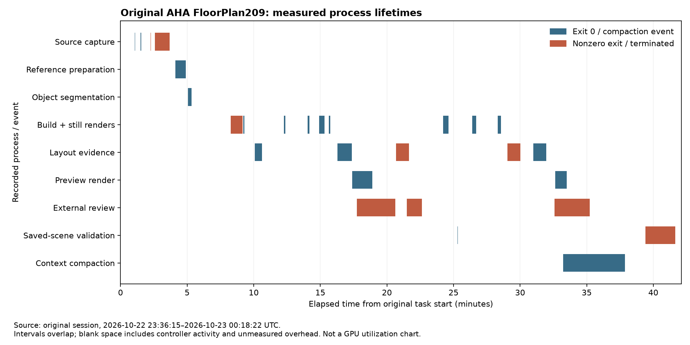

# Original AHA diagnosis — FloorPlan209

Completed 2026-11-16 using the original 2026-10-22 session, frozen authored mesh,
original review logs and existing small-model diagnostics. No reconstruction or
live model call was launched. Historical artifacts remain unchanged.

## Conclusion

The evidence does **not** support treating raw Blender construction as the main
original-AHA bottleneck, or treating general object construction as a validated
small-model replacement target. The actionable problems are:

1. Long-context controller work and workflow overhead, including an expensive
   compaction and repeated ad hoc scripting/inspection.
2. Oversized, contract-invalid visual reviews and repeated evidence generation.
3. Grouped object identity and major-object scope, which obscure existing geometry
   and omit parts of the evaluator's instance inventory.
4. Genuine source-shape and appearance deficiencies that survive strong review.

The strongest new intervention result is identity-only: splitting existing meshes
into individual instances increased distance/size correctness from **8/34 to 14/34**
and IoU correctness from **7/34 to 11/34**, without changing a vertex or using a model.
That is an evaluation/representation improvement, not improved visual reconstruction.

## 1. Measured timeline

The original user task lasted **2,526.419 seconds (42.11 minutes)**. We recovered
133 command execution records, 44 image-view events, 139 outer tool calls and
141 unique model-response usage records. Commands are classified by execution
syntax and retain session line numbers for auditing.



Recorded category durations (process lifetimes, not device utilization):

- External image review: **399.20 s**, three calls, all nonzero exits. Two layout
  reviews and one preview review failed the acceptance contract while also
  reporting geometric/appearance defects.
- Layout evidence preparation: **271.38 s**, five attempts; two failed because
  required object-focus evidence was missing.
- Authored scene builds plus their still renders: **160.66 s**, nine commands,
  including a terminated 53.91-second initial build.
- Preview rendering: **142.67 s**, two commands.
- Saved-scene validation: **135.04 s**, dominated by a 134.07-second process that
  logged `SAVED_SCENE_CHECK_PASSED` but did not terminate normally. Its runtime
  must not be labeled 134 seconds of geometric verification.
- Source capture: **72.44 s** across four commands, including failures.
- Reference preparation: **46.73 s**; object segmentation: **15.67 s**.
- Context compaction: **277.35 s**, overlapping recorded commands for **118.65 s**.

These durations are not additive across categories. The additive wall partition is:

- Recorded commands without compaction: **1,002.54 s (39.7%)**.
- Compaction without recorded commands: **158.70 s (6.3%)**.
- Both: **118.65 s (4.7%)**.
- Outside recorded commands and compaction: **1,246.53 s (49.3%)**.

The last bucket includes main-agent generation, tool dispatch, image handling,
inter-turn activity and unmeasured overhead. It is **not** a measured inference
latency bucket, and we cannot recover a complete causal critical path from it.
The trace nevertheless shows that optimizing Blender execution alone targets a
small fraction of this run: even removing all 160.66 seconds would save at most
6.4% of the original wall interval, before accounting for overlap. This bound
excludes time the model spent authoring code and possible changes to repair count.

The timeline also shows original AHA already overlapping some work: preview
rendering runs while external review proceeds, and preparation runs while the
controller continues. It is not an entirely serial execution baseline.

## 2. Concrete engineering and review failures

**Repeated compressed-array reads in the initial build.** The session records a
terminated 53.91-second build, followed by a patch replacing repeated
`mask['masks'][...]` accesses with a preloaded `all_masks` array. The rerun completed
in 4.28 seconds. Its thread setting also changed to 12, so this is not a controlled
speedup measurement. It does establish a specific numerical/tooling problem worth
fixing in reusable helpers rather than delegating to another language model.
Evidence: `profile.json` process IDs `15078`, `80047`; original `build_v1*.log`.

**Evidence retries failed before they could support review.** The compact v5
packet failed after **57.35 s** with missing plan/side/source focus evidence for
`decor`. The first v8 packet failed after **58.13 s** for `television`; a complete
packet then took **57.95 s**. These are evidence-generation/coverage failures, not
model-reasoning failures. A view planner and coverage check should be explicit.

**Review requests were too broad for the delivered response contract.** The v5
layout request delivered **111 images**. Its response listed all 111 as reviewed,
but its 18 observation entries omitted references to **29 required images**.
The v8 request delivered **92 images**; its 20 entries omitted **26 required images**.
Both raw verdicts were rejected, and the native validator also rejected coverage.
A list of reviewed IDs did not establish concrete per-image inspection.

This supports bounded per-object evidence packets with independently validated
coverage, followed by one room-level synthesis. It does not justify dropping
required views or replacing a strong reviewer with a small model on the same
111-image task. Expensive global review should receive validated object receipts,
material-enabled source/render pairs and unresolved cross-object issues.

**Evidence representation was itself ambiguous.** The author reported that a v5
sideboard-height finding referred to a clipped fireplace mantel in the inspection
view. This is an author's explanation, not independent proof that the review was
wrong. The later v8 review still found a sideboard extent defect. It shows why
inspectable object identity and source-bound evidence matter.

**Final completion also encountered an authorization boundary.** A later external
preview image upload was blocked, and the task ended with an unaccepted candidate.
That boundary is not a geometry or model-capacity failure. This diagnosis does not
retry that historical upload.

## 3. Corrected token accounting

The previously recovered summary used cumulative `token_count` counters. Summing
unique per-response `token_usage_record` entries revealed one additional compaction
response: **250,606 input**, **12,800 cached input**, **5,954 output** tokens.

Corrected main-session totals, including compaction:

- Input: **18,230,987**, including **17,673,472 cached**.
- Uncached input: **557,515**.
- Output: **80,492**, including **23,765 reasoning output**.

The compaction alone accounts for 237,806 uncached input tokens, about 42.7% of this
corrected uncached total. This is evidence for testing bounded task contexts and
compact durable state. It is not an invoice estimate or proof of a particular
cost saving. Separate reviewer counters remain outside these main-session totals;
cache pricing, subscription attribution and actual charges are unknown.

The historical summary is preserved unchanged. The new profiler includes the
compaction receipt and a test verifies that it exactly reconciles the difference.

## 4. Quality diagnosis: identity before more geometry agents

The task's authored scope requested editable major objects. Its segmentation
script used a fixed 14-label category list and merged all masks for a category
within each frame. The authored scene retained 14 semantic roots, including the
room; the evaluator retained 13 nonstructural prediction groups. `side_tables`
contained both tables, and `decor` contained a mirror plus vessels. A sofa pillow
and lower coffee-table shelf were children of their parent objects.

Consequently, **26 missed evaluator instances do not mean 26 physically absent
objects or 26 detection failures**. The evaluator uses separate instances,
including drawers and a shelf, while the author used grouped furniture and an
explicit major-object scope. The original review also called out unaccounted
plants, a rug, accessories and a second door. A complete detected/planned/built/
accepted funnel cannot be recovered because there was no instance-level ledger.

### Identity-only ablation executed now

Using the frozen exported mesh, we split the named mirror, three vessels, pillow
and coffee-table shelf into separate groups. We assigned side-table parts to the
nearest of the two existing tabletop centers. No ground-truth positions were used
to choose these groups, and no geometry, alignment or scoring threshold changed.
The baseline score was reproduced before interpreting the intervention.

- Original: **13 prediction groups**, D **8 correct / 0 misplaced / 26 missed**;
  IoU **7 correct / 1 misplaced / 26 missed**.
- Split identities: **19 prediction groups**, D **14 correct / 1 misplaced /
  19 missed**; IoU **11 correct / 4 misplaced / 19 missed**.
- Newly D-correct: mirror, pillow, shelf, one side table and two vases.
- The other side table became matched but remained misplaced.
- Pillow and shelf pass distance/size but fail IoU; their geometry is still imperfect.

This is a scene-specific exploratory intervention, not a held-out improvement
claim. Splitting the shelf reflects this benchmark's part/instance convention.
Changing parent membership also changes fitted parent boxes. Nothing here alters
the original `.blend` or certifies appearance. Nevertheless, the intervention
establishes that identity grouping materially affected this score.

### Genuine geometric defects remain

The final raw review reported seating arm/base contours, window reveals, side-table
placement and sideboard extent errors. It also lacked material-enabled evidence
for appearance acceptance. Those findings agree with the distinction between
reasonable coarse boxes and source-faithful geometry: the sofa and armchair can
score well on box metrics while retaining visible shape defects.

This directly limits the earlier `aha_next` box-recipe hypothesis. A typed compiler
can reduce code failures; a universal 16-box representation is not established as
sufficient for upholstered furniture, curved fireplace details or lamp shades.

## 5. What can move off the strong agent?

**Move to deterministic tools first:** instance IDs and hierarchy validation,
projection/bounds/support calculations, schema and evidence-coverage checks,
render manifests, reusable scene templates, process completion checks and caching.
The identity ablation and observed coverage failures support this priority. Avoid
spending a smaller-model call on a calculation or invariant that code can enforce.

**Good small-agent candidates, still requiring a matched benchmark:**

- Source inventory auditing: identify distinct items in bounded crops, flag
  missing instance IDs and select useful source views. Require source coordinates
  and allow abstention. Do not merge repeated objects solely by category.
- Asset shortlist ranking: choose among supplied candidates using silhouettes,
  topology and dimensions. Escalate when no candidate fits.
- Bounded parameter proposals: adjust an existing asset/template within reviewed
  coordinate/support constraints; compile and numerically validate changes.
- Local defect triage: inspect one object's complete packet and route uncertain
  or conflicting findings upward. Initially advisory; audit passes with a strong
  reviewer or human labels before granting acceptance authority.

**Keep strong for now:** uncertain camera/scale reasoning, global layout,
complex source-shape construction, cross-object conflicts and final acceptance.
These are the areas with unresolved original-run defects, not demonstrated cheap
replacement successes.

The seven archived Qwen diagnosis records are sequential debugging experiments,
not a controlled accuracy study. Two forced-output trials truncated; another
provider returned no executable code; a text response exposed JSON-fence handling.
Two bounded-code controls parsed and compiled but failed duplicate semantic IDs
in Blender. One contract-fixed text response executed successfully; it did not
establish visual acceptance. Therefore no task class has yet been demonstrated
safe for autonomous small-model replacement by these records.

## 6. Next implementation and measurement priorities

1. Establish a source-derived per-instance manifest and explicit target scope.
   Preserve separate IDs for repeated objects and supported accessories.
2. Make view coverage and per-image review schema validation deterministic. Separate
   object-local geometry review from global/appearance review; retain every required
   view and revision binding.
3. Replace recurring glue scripts with reusable operations, preload numerical
   arrays, bound process shutdown and retain compact typed task state.
4. Benchmark small-model inventory/asset/parameter/triage tasks on identical frozen
   packets. Count harmful edits, false passes, abstentions, escalation and cost per
   accepted task. Use human-reviewed labels; strong-model agreement is not truth.
5. Then test bounded parallel proposals/reviews with frozen camera/support state.
   Hold routing fixed when testing concurrency, and keep canonical merge serial.
   Measure actual critical-path reduction instead of extrapolating from Blender
   microbenchmarks. Smaller-model speed and quality are still unmeasured here.

## Reproduce

From `agen3d/`, outputs must be new:

```bash
.venv/bin/python diagnose/profile_original.py \
  --session /home/mj/.codex/sessions/2026/10/22/rollout-2026-10-22T19-36-13-01a165f8-e5e3-7be2-87f4-0d5892de3331.jsonl \
  --start 2026-10-22T23:36:15.819Z --end 2026-10-23T00:18:22.238Z \
  --output diagnose/results/original-profile-NEW

.venv/bin/python diagnose/collect_evidence.py \
  --original-run /home/mj/dl_project/repos/aha-3d/runs/ai2thor_floorplan209 \
  --probes recon/qwen-diagnosis-20261116 \
  --output diagnose/results/original-profile-NEW/review-and-model-evidence.json

.venv/bin/python diagnose/identity_ablation.py \
  --evaluation recon/ai2thor_floorplan209/aha3d_ori/eval \
  --ground-truth recon/ai2thor_floorplan209/ground_truth/boxes.json \
  --output diagnose/results/identity-ablation-NEW

MPLCONFIGDIR=/tmp/aha-diagnose-matplotlib .venv/bin/python diagnose/plot_profile.py \
  diagnose/results/original-profile-NEW/profile.json \
  --output diagnose/results/original-profile-NEW/timeline.png

.venv/bin/python -m pytest -q diagnose/tests
```

Canonical measured outputs:

- [Profile and per-response usage](results/original-profile-20261116-v2/profile.json)
- [Command timing CSV](results/original-profile-20261116-v2/commands.csv)
- [Review coverage and historical model probes](results/original-profile-20261116-v2/review-and-model-evidence.json)
- [Identity ablation and per-object score changes](results/identity-ablation-20261116/identity-ablation.json)

The first `original-profile-20261116` directory is an intermediate output: its
heuristic counted a zero-duration documentation command as external review.
`original-profile-20261116-v2` corrects that classification. Timing totals are
unchanged. Five diagnosis tests pass; the timeline was visually inspected.
